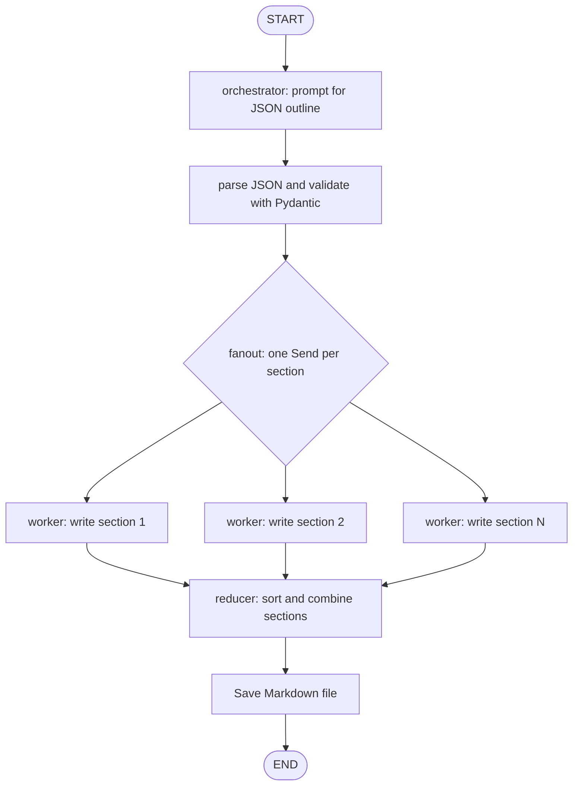

Local LLM Blog Generator (LangGraph)
A learning project that generates Markdown blog posts with a locally cached Hugging Face language model and LangGraph. The graph creates an outline, generates sections in parallel, restores their original order, and writes the final Markdown file.

This project uses local inference rather than the OpenAI API. local_files_only=True prevents Transformers from downloading missing model files during startup.
Features
- Local Hugging Face causal language model; defaults to Qwen/Qwen2.5-3B-Instruct.
- Detailed Pydantic plan validation: audience, tone, section goals, 3–5 bullets per section, and word targets.
- Enforces 5–7 sections, consecutive IDs, unique headings, and exactly one common_mistakes section.
- JSON-prompt-based planning, compatible with base LLM integrations that do not implement with_structured_output().
- LangGraph fan-out with Send for parallel section generation.
- Reducer combines results in planned section order.
- Writes the final blog to generated_blogs/.
Architecture

Parallel workers may finish in a different order. Each result is tagged with its section ID; the reducer sorts by that ID before writing the blog. The sections state field uses Annotated[List[str], operator.add] to merge worker outputs.
Project structure
BlogGenerator/
├── blog_generator.py
├── blog_generator.ipynb          # step-by-step notebook version
├── README.md
├── requirements.txt
└── generated_blogs/          # created automatically
Cached models
Your local Hugging Face cache listing showed:
- Qwen/Qwen2.5-3B-Instruct
- sentence-transformers/all-MiniLM-L6-v2
- TinyLlama/TinyLlama-1.1B-Chat-v1.0
The Qwen model is the default. The embedding model is not needed by this workflow. TinyLlama can be selected using --model.
Jupyter notebook
Open blog_generator.ipynb in Jupyter or VS Code to follow the workflow in cells: schemas, local model setup, graph construction, and generation. The notebook uses the same local-cache assumptions as the script.
Installation
Use the Python version and virtual environment configured for your project. Install dependencies into the active environment:
python -m pip install -U pip
python -m pip install langgraph langchain-core langchain-huggingface transformers torch accelerate pydantic
If your repository already has a shared requirements.txt, merge these dependencies into it instead of replacing existing entries.
Run
python blog_generator.py --topic "Self Attention"
Select a cached model explicitly:
python blog_generator.py --topic "How RAG works" --model "Qwen/Qwen2.5-3B-Instruct"
Try TinyLlama:
python blog_generator.py --topic "Introduction to LangGraph" --model "TinyLlama/TinyLlama-1.1B-Chat-v1.0"
The output is written to a title-based Markdown filename under generated_blogs/.
Code walkthrough
1. Pydantic models
- Task defines an ID, heading, reader goal, ordered bullets, target word count, and section type.
- Plan defines the blog title, target audience, tone, and 5–7 tasks.
- Pydantic validators enforce consecutive IDs, unique titles, valid word targets, and exactly one common_mistakes section.
- parse_plan() extracts JSON from the model output and validates it using Plan.model_validate().
2. Why the planner uses JSON prompting
HuggingFacePipeline is a base LLM integration and may raise NotImplementedError for with_structured_output(). The orchestrator therefore asks the model to return JSON, then validates that JSON with Pydantic. This avoids relying on structured-output support in the model integration.

If the model returns malformed JSON, the program raises a readable error containing the model output. In a future enhancement, we can add a retry/repair step.
3. Graph state and reducers
BlogState carries the topic, plan, generated sections, final Markdown, and output path. The sections field uses operator.add to concatenate lists returned by parallel workers.
4. Fan-out workers
The fanout() function uses LangGraph's Send to dispatch one task per outline section. Each worker receives the overall topic, plan, and its own Task.
5. Reducer
The reducer sorts results by section ID, combines them, and writes the Markdown output. Sorting ensures parallel completion timing does not change the intended section order.
Troubleshooting
Model not found locally
ls -lah ~/.cache/huggingface/hub/
The script intentionally uses local_files_only=True. If the model cache is incomplete, choose another cached model or download the model files separately before running.
Invalid JSON from the model
The planner requires a JSON object with blog_title, audience, tone, and tasks. Each task must include id, title, goal, bullets, target_words, and section_type. If the local model returns invalid JSON or violates the plan constraints, run it again. A retry-and-repair node can be added later.
PyTorch or MPS problems
python -c "import torch; print(torch.__version__); print(torch.backends.mps.is_available())"
Device support depends on your installed PyTorch and Transformers versions. The script defaults to device_map="auto".
Slow or incomplete generations
Generation time depends on the model, available memory, device, prompt length, and max_new_tokens in build_llm().
Current limitations
- Syntax was checked while preparing the project, but model inference must be tested in your local virtual environment.
- The model can still return malformed JSON or low-quality sections.
- The generator does not browse the web or fact-check the content.
- No retries, quality-review node, or automated tests are included yet.
Future enhancements
Keep this section updated as the project evolves:
- Retry and repair malformed planning JSON.
- Add a configurable number of sections and output token limits.
- Add an editor/quality-review node.
- Add RAG and grounded citations.
- Add automated tests and logging.
- Add a Streamlit interface or FastAPI endpoint.
- Add configuration for temperature and output directory.
Learning concepts
- LangGraph StateGraph, START, and END
- Parallel fan-out using Send
- Shared graph state and reducers
- Pydantic validation of model-generated JSON
- Schema-driven technical writing prompts and section-level constraints
- Local Hugging Face inference
- Markdown file generation