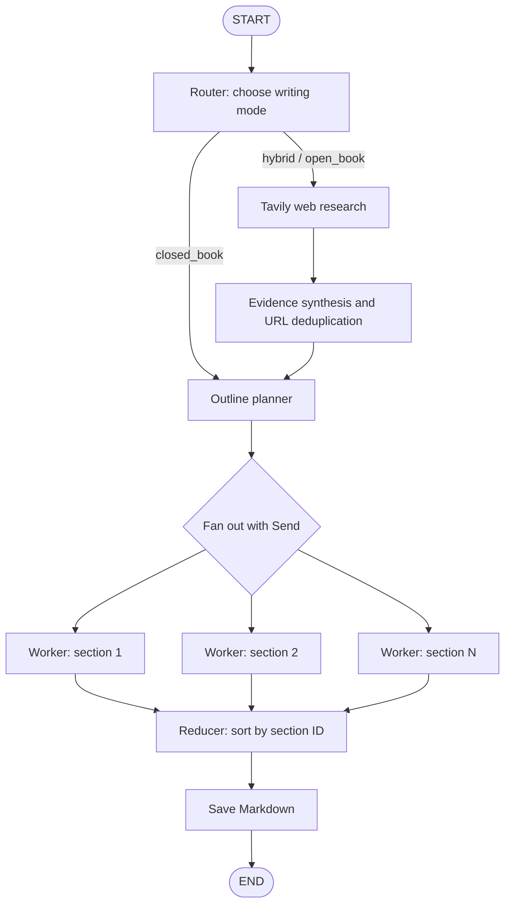

Research-Aware Blog Generator (LangGraph)
A technical blog generator built with LangGraph, OpenAI, and Tavily Search. It decides whether a topic needs web research, gathers and synthesizes evidence when needed, creates a structured outline, writes sections in parallel, restores their original order, and saves the result as a Markdown file.

The Python script blog_generator.py is the current source of truth for this research-enabled workflow.
Features
- Research router: classifies topics as closed_book, hybrid, or open_book.
- Search on demand: uses Tavily only when the router decides current web evidence is useful or necessary.
- Structured outputs: uses Pydantic schemas through ChatOpenAI.with_structured_output() for routing, evidence synthesis, and blog planning.
- Evidence-aware writing: passes retrieved URLs and snippets to workers; open-book sections are instructed to cite supplied URLs and avoid unsupported claims.
- Detailed planning: plans 5–9 sections, each with a goal, 3–6 bullets, a word target, tags, and flags for research, citations, and code.
- Parallel section writing: LangGraph Send fans each planned section out to a worker.
- Stable ordering: workers return section IDs; the reducer sorts sections before combining them.
- Markdown output: saves the final article under generated_blogs/ by default.
- Optional .env support: loads OPENAI_API_KEY, TAVILY_API_KEY, and OPENAI_MODEL from a project-level .env file.
Architecture

Workflow stages
1. Router — decides whether the topic is evergreen or depends on current information.
2. Research — runs the router's focused queries through Tavily, normalizes results, asks the model to synthesize an evidence pack, and filters the pack so its URLs must come from the search results.
3. Orchestrator — creates and validates a structured outline with 5–9 sections.
4. Fan-out — uses LangGraph Send to dispatch one task payload per section.
5. Workers — independently write Markdown sections using the outline, writing constraints, and available evidence.
6. Reducer — sorts results by section ID, builds the complete Markdown article, and writes it to disk.
Project structure
BlogGenerator/
├── blog_generator.py
├── blog_generator.ipynb       # older local-model learning notebook
├── README.md
├── requirements.txt
├── .env                       # create locally; do not commit
└── generated_blogs/           # created automatically
Note: The existing notebook was created for the earlier local Hugging Face version. It does not yet mirror the research-enabled OpenAI/Tavily script. Run blog_generator.py for the workflow documented here.

Requirements
- Python 3.12 recommended
- An OpenAI API key
- A Tavily API key when web research is selected
- Internet access for OpenAI calls and Tavily search
Setup on macOS
From your project directory:
cd ~/Development/AI_DEVELOPMENT/LangGraph/BlogGenerator

# Activate your existing virtual environment
source venv/bin/activate

# Install dependencies
pip install -r requirements.txt
Create a .env file in the project root:
OPENAI_API_KEY=your_openai_api_key
TAVILY_API_KEY=your_tavily_api_key
OPENAI_MODEL=gpt-4.1-mini
Replace the example values with your own keys. Keep .env private and add it to .gitignore; never commit API keys.

OPENAI_API_KEY is required for every run. TAVILY_API_KEY is required only when the router selects a research mode. For a topic that needs no research, the script should proceed in closed_book mode without Tavily.
Run the generator
python blog_generator.py --topic "Self Attention"
Example with a current topic:
python blog_generator.py --topic "State of Multimodal LLMs in 2026"
Choose a different output directory:
python blog_generator.py \
  --topic "Building Reliable RAG Applications" \
  --output-dir generated_blogs
The script prints the generated Markdown and writes a file in generated_blogs/. The filename is derived from the generated blog title.
Research modes
Mode	When it is selected	Expected behavior
closed_book	Evergreen topics, such as core concepts and fundamentals	Writes without a web-research step
hybrid	Mostly evergreen topics that benefit from fresh examples or tool/model updates	Uses evidence for current claims and requests citations for affected sections
open_book	Volatile topics such as latest releases, rankings, pricing, policy changes, or news roundups	Uses evidence-grounded reporting; the outline is planned as a news_roundup

The router determines the mode before the outline is generated. The model can make routing mistakes, and search results may be incomplete, so review current claims and citations before publishing.
Key LangGraph concepts used
- StateGraph: defines the overall workflow and state shared between nodes.
- Nodes: router, research, outline planner, section worker, and reducer functions.
- Conditional edges: route to research or directly to planning based on the router result.
- Send: creates one worker invocation per outline task, allowing parallel section generation.
- Reducer: Annotated[List[tuple[int, str]], operator.add] appends worker results to the shared section list.
- Structured output: Pydantic schemas constrain the router decision, evidence pack, and outline.
- END: the workflow completes after the reducer saves the Markdown article.
Troubleshooting
OPENAI_API_KEY is not set
Confirm the .env file exists in the project root, has a valid OPENAI_API_KEY, and that python-dotenv is installed. Do not include quotes unless they are part of the key.
TAVILY_API_KEY is required
The router chose a research mode. Add a valid TAVILY_API_KEY to .env, or choose an evergreen topic if research is not needed.
Tavily import error
Install the current integration:
pip install -U langchain-tavily
The script uses from langchain_tavily import TavilySearch rather than the deprecated TavilySearchResults import from langchain-community.
OpenAI structured-output or API errors
Check that your API key is valid, your account can access the configured model, and package dependencies are installed in the active virtual environment. You can change the model through OPENAI_MODEL in .env.
Too few sections in the generated plan
The script expects 5–9 sections and stops with a clear error if the outline violates that requirement. Retry the run; if it happens repeatedly, tighten the planner prompt or add a controlled retry.
Research claims are weak or unsupported
Search results can be noisy and publication dates may be absent. Review the cited URLs directly, confirm dates before publishing, and remove claims that the evidence does not support. The code filters synthesized evidence to URLs returned by Tavily, but that does not guarantee every claim is accurate.
Dependencies
The primary dependencies are listed in requirements.txt:
- langgraph
- langchain-openai
- langchain-tavily
- pydantic
- python-dotenv
Suggested next improvements
- Add retries for temporary API and structured-output failures.
- Add automated checks for citation coverage and section word counts.
- Store source metadata and generated articles as run artifacts.
- Add LangSmith tracing for debugging and evaluation.
- Create a matching notebook for the research-enabled workflow.